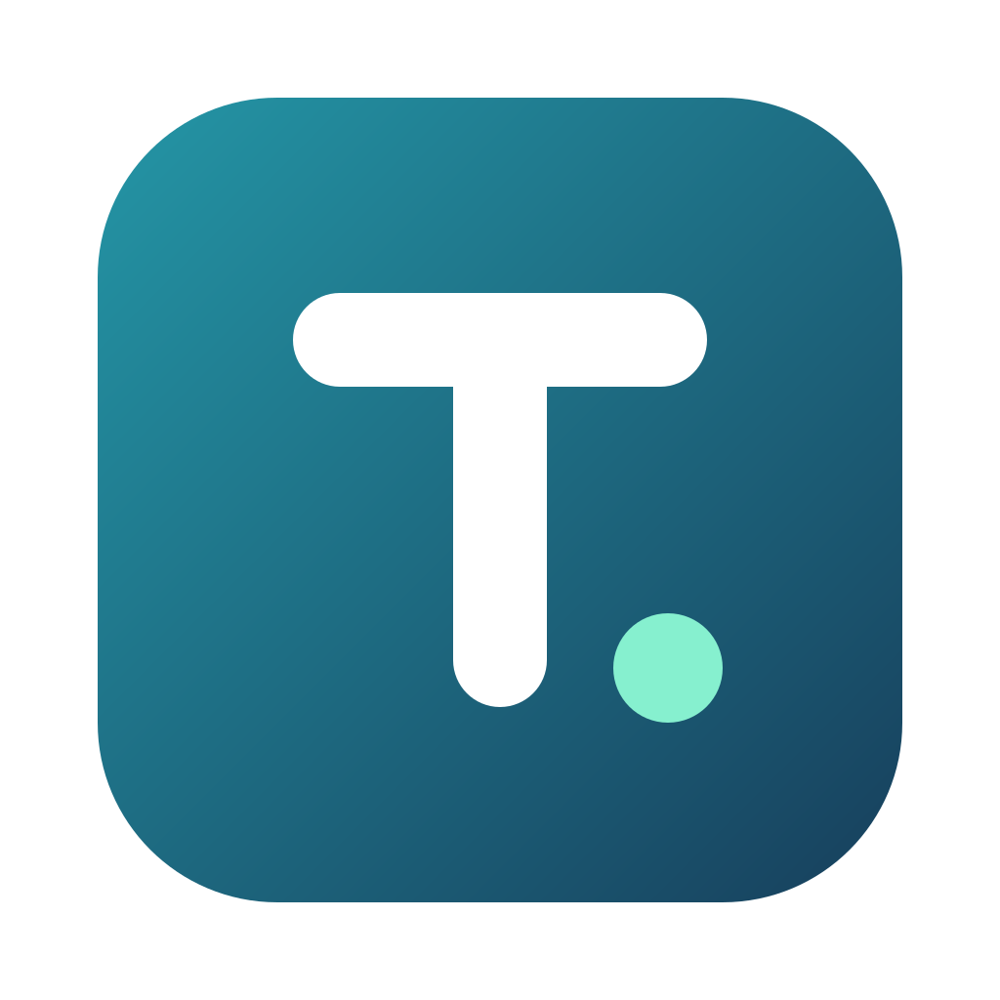

<p align="center"></p>

<h1 align="center">Typster</h1>

<p align="center">A fast desktop editor for <a href="https://typst.app">Typst</a> with an instant preview and serverless live sharing.</p>

## Features

* **Instant preview.** The Typst compiler runs natively inside the app. Edits are compiled as you type, incrementally, and only the pages that changed are redrawn.
* **Real editor.** Syntax highlighting, inline errors and warnings, autocompletion (including every package on Typst Universe and your local packages) and hover docs from the official Typst IDE crate, folding, search and multiple cursors.
* **Preview and source stay in sync.** Click anywhere in the preview to jump to its source, the preview follows your cursor.
* **Live sharing without a server.** Share a project with a ticket and edit together in real time, with everyone's cursors visible. No account, no port forwarding.
* **Whole projects.** Multi-file projects, images, bibliographies, project fonts and `@preview` packages all work, for you and for the people you share with.
* **Safe with your files.** Autosave with conflict detection when files change outside the app, atomic writes, and deletions go to the system trash.
* **Drag and drop.** Drop files onto the file tree to copy them into a folder, or drop an image onto the editor to add it next to the open file with an `#image(...)` call.
* **Several projects at once.** Each window holds its own project. Double clicking a `.typ` file opens it in the window that already shows its folder, or in a new window.
* Light and dark themes that follow your system. Exports PDF. Updates itself.

## Live sharing

Click **Share**, then **Start sharing**, and send the ticket to the people you want to write with (any chat works). They open Typster, choose **Join a session** and paste it.

Under the hood the connection uses [iroh](https://iroh.computer): QUIC with NAT hole punching. Peers connect directly whenever their networks allow it, which is most of the time. When they can't (some corporate or mobile networks), traffic falls back to the public relays run by n0, the iroh developers. Relays only see encrypted packets. On the same local network, peers connect directly without any relay.

Things to know:

* The ticket is the key. Anyone who has it can edit the project until you stop sharing, and it contains your IP addresses.
* Edits use a CRDT ([Yjs](https://yjs.dev)), so people can type in the same file at the same time without conflicts.
* Each person compiles the document on their own machine. Fonts installed on your system but missing on theirs fall back to defaults, fonts stored in the project folder are shared.
* Guests edit an in-memory copy. Only the host's disk is written to. When the session ends, guests can save a copy.

## Install

Download the installer for your platform from [Releases](../../releases). Installing registers Typster for `.typ` files. Typster checks for new versions on launch and offers to install them (on Linux this works for the AppImage; the `.deb` and `.rpm` update through your package manager).

On Arch, EndeavourOS and other distributions without `.deb` or `.rpm` support, use the AppImage. It needs FUSE 2 (`sudo pacman -S fuse2` on Arch), then make the file executable and run it.

Builds are not code signed yet, so macOS and Windows warn the first time you open the app. On macOS, right click the app and choose **Open**; on Windows, choose **More info** and then **Run anyway**.

## Build from source

You need [Rust](https://rustup.rs) 1.92 or newer, [Node.js](https://nodejs.org) 22 (see `.node-version`) and [pnpm](https://pnpm.io). On Linux, also install the WebKit and SSL development packages (Debian and Ubuntu shown):

```sh
sudo apt install libwebkit2gtk-4.1-dev libxdo-dev libssl-dev librsvg2-dev
```

Then:

```sh
pnpm install
pnpm tauri dev      # run in development
pnpm tauri build    # build an installer for your platform
```

Checks:

```sh
pnpm check                                       # TypeScript
cargo test --manifest-path src-tauri/Cargo.toml  # Rust, including a real peer to peer session over loopback
```

You can also open a folder or file from the terminal: `typster path/to/thesis`.

### Publishing releases

Bump the version in `src-tauri/tauri.conf.json`, `src-tauri/Cargo.toml` and `package.json`, commit, then push a matching tag (for example `git tag v0.2.0 && git push origin main v0.2.0`). The release workflow builds every platform into a draft release and publishes it once all of them succeed, which is what makes installed copies update. If a build fails, the release stays a draft. A tag that doesn't match the version stops the workflow before it builds anything.

Updates are signed. The public key is in `tauri.conf.json`; the private key must be stored as the repository secret `TAURI_SIGNING_PRIVATE_KEY` (and its password, if it has one, as `TAURI_SIGNING_PRIVATE_KEY_PASSWORD`). To create a new pair, run `pnpm tauri signer generate -w ~/.tauri/typster.key` and put the new public key in `tauri.conf.json`. Keep the private key safe: without it, existing installs can't verify new updates.

## Keyboard shortcuts

| Shortcut | Action |
| --- | --- |
| Ctrl+S | Save now (Typster also autosaves) |
| Ctrl+O | Open a folder |
| Ctrl+Shift+N | New window |
| Ctrl+E | Export PDF |
| Ctrl+B | Toggle the sidebar |
| Ctrl+= / Ctrl+- / Ctrl+0 | Zoom the preview in, out, or to fit |
| Ctrl+Space | Autocomplete |
| F2 / Delete | Rename or delete the selected file |

On macOS, use Cmd instead of Ctrl.

## How it's built

* `src-tauri/src/engine.rs`: a compiler thread that owns the Typst world, compiles the newest state, diffs pages by hash and serves IDE requests.
* `src-tauri/src/world.rs`: the Typst `World`, serving unsaved buffers from memory on top of the project folder and packages.
* `src-tauri/src/share.rs`: the iroh endpoint, tickets and framing for live sharing.
* `src-tauri/src/project.rs`: file access confined to the project folder.
* `src-tauri/src/windows.rs`: per-window state, and routing files opened from the OS to the right window.
* `src-tauri/src/packages.rs`: the package list behind import autocompletion.
* `src/project.ts` and `src/collab.ts`: the Yjs document that holds the project, and its sync protocol between peers.
* `src/editor.ts` and `src/preview.ts`: CodeMirror and the SVG preview.
* `src/drop.ts`: files dropped from the OS.

## License

[MIT](LICENSE)
