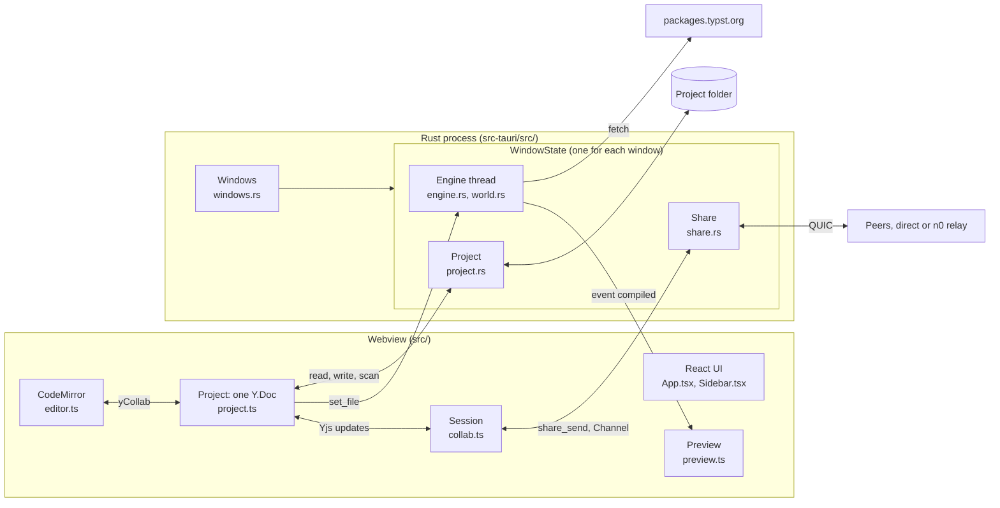
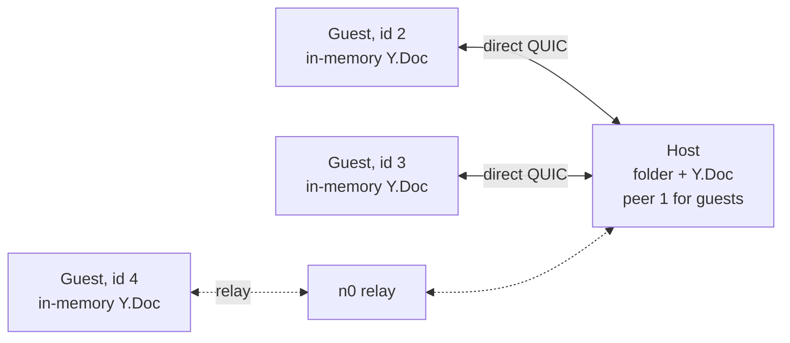
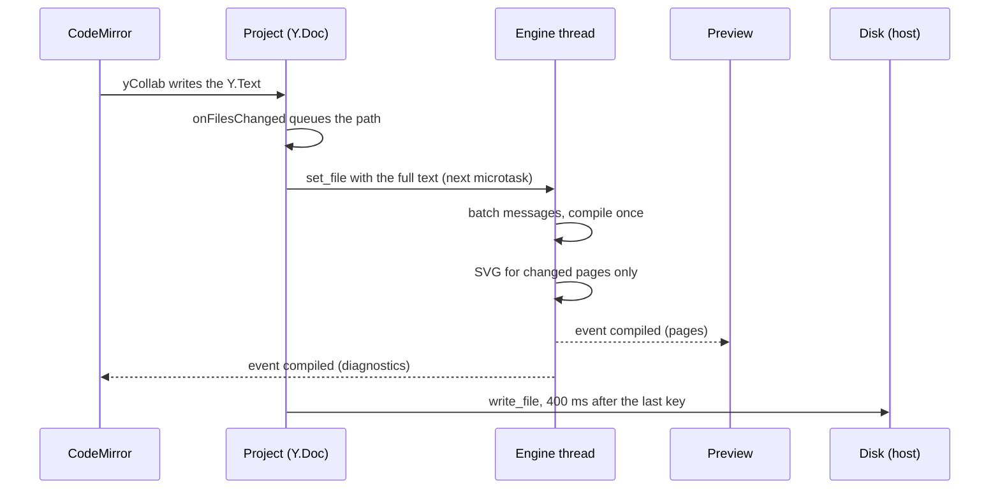
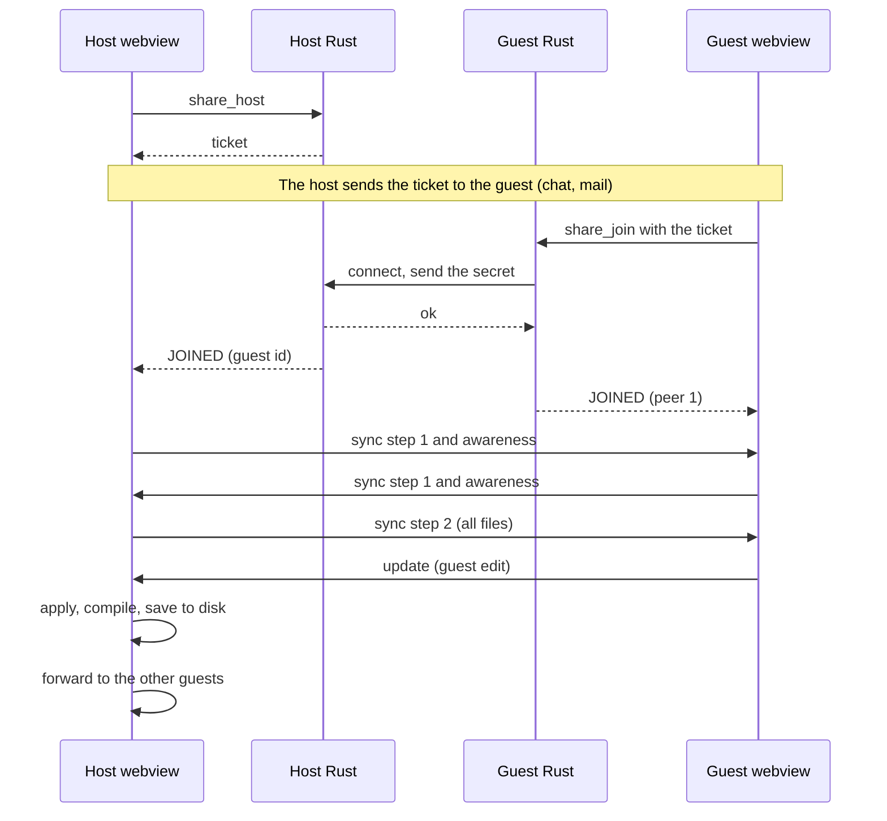

# Typster architecture

Typster is a Tauri 2 desktop app. The webview keeps each project as one Yjs document. Each window has one Rust thread that compiles the newest state with Typst and sends SVG pages back. The host saves the document to disk. Live share sends Yjs updates to peers over iroh.

References in this document name a file and a symbol (for example `engine.rs` `run`), so they stay valid when lines move. Rust files are in `src-tauri/src/`, TypeScript files are in `src/`.

## Overview

The Y.Doc in the webview is the source of truth for each window. The compiler thread gets a copy of each change, the host disk gets the saves, and the peers get the updates. Thus solo edits and shared edits go through the same code.

## Terms

| Term | Meaning |
|---|---|
| Tauri | A framework for desktop apps. The UI is a web page, and the backend is a Rust program. |
| Webview | The embedded browser that shows the web page of a Tauri window. |
| Command | A Rust function with `#[tauri::command]`. The webview calls it with `invoke`. |
| Event | A message that Rust sends to the webview with `emit_to`. The webview receives it with `listen`. |
| Yjs | A CRDT library. A CRDT (conflict-free replicated data type) lets many copies of a document take edits and then merge them without conflicts. |
| Awareness | The part of y-protocols that sends short state about each person (name, color, cursor, open file). It is not saved. |
| Origin | A value attached to a Yjs transaction. Typster reads it to know where a change came from. |
| Overlay | The in-memory files of the Typst world. They override the files on disk. |
| comemo | The memoization library of Typst. It keeps results of earlier compiles, so the next compile does less work. |
| iroh | A Rust library for QUIC connections between two devices. It uses NAT hole punching and falls back to a relay server. |
| Microtask | A JavaScript callback that runs when the current task ends, before the browser does other work. |

## Source map

| File | Role |
|---|---|
| `src-tauri/src/main.rs` | App start: plugins, managed state, setup, window events, command list. |
| `src-tauri/src/windows.rs` | `Windows` and `WindowState`: one engine, project and share session for each window. Routes paths from the OS to a window. |
| `src-tauri/src/project.rs` | All disk access: open, read, write, delete, rename, scan. Path rules and conflict checks. |
| `src-tauri/src/engine.rs` | The compiler thread: batches, compile, page diff, SVG, IDE requests, PDF export. |
| `src-tauri/src/world.rs` | `TypsterWorld`, the `typst::World` of Typster: file loader, fonts, packages, time. |
| `src-tauri/src/packages.rs` | The Typst Universe package index for autocomplete. |
| `src-tauri/src/share.rs` | Live share transport over iroh: tickets, authentication, frames, routes. |
| `src/main.tsx` | Starts `init` and renders `App`. |
| `src/actions.ts` | The glue: listeners, project open and close, files, export, share, shortcuts, updates. |
| `src/ipc.ts` | One typed wrapper for each command, plus the shared types. |
| `src/store.ts` | The zustand store. Plain state, no actions. |
| `src/project.ts` | `Project`: the Y.Doc, autosave, conflicts, disk sync, mirror to the compiler. |
| `src/editor.ts` | The CodeMirror editor: Typst grammar, autocomplete, hover, lint marks, `yCollab`. |
| `src/preview.ts` | The preview pages: SVG update, zoom, click to source. |
| `src/collab.ts` | `Session`: the Yjs sync and awareness protocol on top of the share transport. |
| `src/App.tsx`, `src/Sidebar.tsx`, `src/ShareDialog.tsx` | The React UI. |
| `src/drop.ts` | Drag and drop of files and folders. |

## Process and windows

One process serves all windows. The single instance plugin catches a second launch and sends its file paths to the first process (`main.rs`).

- `Windows` is the only managed state. It maps each window label to one `WindowState`.
- A `WindowState` holds an `Engine` (the compiler thread), a `Project` (the open folder), a `Share` (the share session) and the paths of the last drop.
- Each command gets the `Webview` and calls `windows.of(&webview)` to find its state. The first call for a label makes the state and starts its compiler thread.

When the OS asks Typster to open a path, `Windows::open` selects a window. It prefers a window whose folder contains the path, then an empty window, then a new window. It stores the path as a queued path and emits `open-pending` to that window. The webview then calls `take_pending_path`.

When a window closes, `Windows::closed` removes its state and stops its share session. The compiler thread then stops, because its channel has no sender.

## The project model

Typster uses Yjs for solo edits too. Thus a solo project and a shared project have the same model (`project.ts` `Project`).

- `Project` holds one `Y.Doc`.
- The `files` map has one key for each relative path. The value is a `Y.Text` for a text file, or a `Uint8Array` for other files.
- The `meta` map holds the key `main`, the main file of the project.
- `awareness` holds the name, color and open file of each person.

A file is text if its extension is in `TEXT_EXTENSIONS` and its bytes are valid UTF-8. If the bytes are not valid UTF-8, the file stays as bytes. Thus a save never corrupts it.

Each change has an origin. The origin tells Typster where the change came from:

- `FROM_DISK` (the string `"disk"`) marks a change that came from disk.
- A number marks a change from a peer. The number is the peer id.
- All other origins (for example the origin of `yCollab`) mark a local edit.

`onFilesChanged` observes every change in `files`. It always queues the file for the compiler. If the project has a folder and the origin is not `FROM_DISK`, it also schedules a disk write. Thus a host saves its own edits and the edits of guests.

## Disk access

The webview has no file system permission (`capabilities/default.json`). All disk access goes through the commands in `project.rs`.

**Open.** `Project.open` calls `open_project`. The backend walks the folder and returns the file list and a main file. The walk skips hidden names, `node_modules`, `target` and symlinks, and it stops at 5000 files. The main file is `main.typ`, or else the shallowest `.typ` file. Typst has no project file, so the main file that the user chose last time comes from `localStorage`.

The webview reads every file of 20 MB or less, 32 files at a time. It puts all files into the document in one `FROM_DISK` transaction. `open_project` also tells the compiler thread to open the folder.

**Autosave.** A text edit schedules a save after 400 ms. Typster saves a new or replaced file immediately. A deleted key calls `delete_file`, which moves the file to the trash. `write_file` writes a temporary file and then renames it, so a crash never leaves a half-written file. Ctrl+S, a project close and an app update call `saveAll`, which saves all queued files now.

**Conflicts.** The backend keeps a stamp (modified time and length) for each file that it read or wrote. Before a write, `check_overwrite` compares the file on disk with this stamp:

- If the file is on disk but Typster did not load it, `write_file` returns `"exists"`. The webview shows an error and keeps the file on disk as it is.
- If the file changed since the last read or write, `write_file` returns `"conflict"`. The webview shows a toast with two choices: "Keep mine" (a forced write) and "Reload".

**External edits.** When the window gets focus, the host calls `syncFromDisk`. `scan_disk` walks the folder again and returns the changed, added and removed files. If a changed file has unsaved edits, Typster shows the conflict toast. If not, `reload` changes the file in place with `replaceText`, so editors and peers keep their cursors.

**Path rules.** Paths come from collaborators too, so `resolve` accepts a relative path only if each part:

- is a normal name (no `..`, no absolute path, no drive prefix),
- does not start with a dot and is not `node_modules` or `target` (the same rule as the walk),
- is not a symlink.

Thus a path cannot point outside the folder, and peers cannot write files that the walk does not list. `write_file` also refuses data over 20 MB, and `delete_file` moves only files that Typster loaded to the trash.

## The compiler thread

Each window has one OS thread with the name `typst` and a 64 MiB stack (`engine.rs` `Engine::spawn`). The thread owns the Typst world, so the world needs no lock. `Engine` is only the sender side of a channel.

The loop in `run` works in batches:

1. It waits for one message, then takes all other queued messages.
2. It sorts the batch so that edits come before requests. Thus a completion request sees the newest text.
3. It applies each message. An edit sets the `dirty` flag.
4. If `dirty` is set, it compiles one time.

There is no debounce timer. While a compile runs, new edits wait in the channel. The next batch applies all of them and compiles only the newest state.

`compile` does these steps:

- If there is no main file, it sends zero pages.
- It calls `typst::compile`. After the compile, `comemo::evict(10)` removes old cache entries.
- If the compile succeeds, `diff_pages` hashes each page with `hash128`. It renders SVG only for changed pages. An unchanged page goes out with `svg: null`.
- If the compile fails, `pages` is null. The webview then keeps the last good preview.
- `catch_unwind` catches a Typst panic, so the thread stays alive.
- The result goes to the window as the event `compiled`.

The same thread answers the IDE requests with `typst_ide`: `autocomplete`, `tooltip`, `jump_from_click` and `jump_from_cursor`. A request carries a `oneshot` channel for the reply. A click on a link in the preview opens only `https://`, `http://` and `mailto:` URLs, because a shared document is not trusted.

`export_pdf` writes the PDF only if the last compile succeeded. `save_copy` writes the in-memory files to a folder, and a guest uses it to keep a shared project.

## The Typst world

`TypsterWorld` is the `typst::World` of Typster (`world.rs`). Its `Loader` finds the bytes of a file in this order:

1. The overlay, which holds the buffers from `set_file`. The webview sends every file of the document, so the overlay holds the open project.
2. A cache of bytes that came from disk earlier.
3. The project folder through `FsRoot`, or a package through `SystemPackages::obtain`. A guest has no folder, so a file outside the document is "not found".

Fonts load one time for each process (`BaseFonts::shared`). Typster takes the fonts that `typst-kit` embeds, and it scans the system fonts. Project fonts (`.ttf`, `.otf`, `.ttc`, `.otc`) come first, so they win over system fonts with the same name.

`packages.rs` loads the index of Typst Universe packages for autocomplete. It keeps a copy in the app cache folder and gets a new copy after 24 hours. The download of a package for a compile occurs inside `typst-kit`. During a download, the backend emits the `status` event, and the toolbar shows a spinner.

## Editor

Each window has one CodeMirror `EditorView` (`editor.ts` `editor`). `show` makes a new `EditorState` when the path or the `Y.Text` changes.

- `yCollab` connects the `Y.Text` to the editor. It also shows the cursors of peers from awareness.
- Each file has its own `Y.UndoManager`. It tracks only the editor origin, so undo never removes a peer edit or a disk reload.
- For `.typ` files the editor adds the Typst grammar, autocomplete and hover. Autocomplete calls `complete`, and hover calls `tooltip`.
- The diagnostics come from the `compiled` event. `setDiagnostics` shows them as lint marks for the current file.
- When the cursor stops for 250 ms, `onCursorRest` calls `jump_cursor`, and the preview scrolls to that position.

## Preview

`Preview` controls its own DOM, outside React (`preview.ts`). `update` puts each new SVG string into its page element. If `svg` is null, the page stays as it is. The CSP in `tauri.conf.json` has `script-src 'self'`, so an SVG from a document cannot run an inline script.

A `ResizeObserver` and the zoom value set the page size. Ctrl and the mouse wheel change the zoom. A click converts the point to page points and calls `jump_click`. If the target is a project file, the editor opens that file at the offset.

## UI shell

`store.ts` is a zustand store with plain state and no actions. The logic is in `actions.ts`, which calls `setState` directly.

`App` shows `Welcome` if no project is open. If not, it shows `Workspace`: the `Toolbar`, the `Sidebar`, the `EditorPane`, a `Splitter`, the `PreviewPane` and the `StatusBar`. `Sidebar` makes a tree from the flat list of paths, so an empty folder cannot exist.

`init` (`actions.ts`) connects all parts when the webview starts:

- It listens for `compiled`, `status`, `open-pending` and `save-all`.
- It starts drag and drop, and it sets the click and cursor callbacks.
- It opens a default file when no file is open.
- It syncs from disk on focus, and it asks before a close.
- It adds the shortcuts, opens the queued path and looks for updates.

Shortcuts (Ctrl or Cmd): S saves, O opens a folder, E exports a PDF, B shows or hides the sidebar, plus, minus and 0 change the zoom, Shift+N opens a new window.

Drag and drop uses the native Tauri drop event (`drop.ts`). If no project is open, a drop on the welcome card opens the first path. If a project is open, the files go into the folder under the pointer. `read_dropped` reads only paths from the last drop, and only files up to 20 MB. A drop of images on a `.typ` file also adds `#image(...)` lines.

## Live share

### Transport (`share.rs`)

iroh tries a direct connection first. If the networks block it, the traffic goes through a public relay of n0, the iroh team. The relay sees only encrypted packets.

`share_host` binds an endpoint with `presets::N0` and waits up to 8 seconds for a relay. Then `Session::host` makes a random 16-byte secret. The ticket is `typster:` + the secret in hex + `:` + the iroh `EndpointTicket`. The `EndpointTicket` holds the endpoint id, the IP addresses and, if the endpoint reached one, the relay URL.

`accept` gives each guest an id of 2 or more. The guest must send the secret in 15 seconds. The host compares it in constant time, and it accepts up to 32 guests. Then it replies `ok`.

The topology is a star. Each guest connects only to the host, and a guest sees the host as peer 1. The host forwards the updates between guests. `watch_route` examines each connection every 2 seconds and reports `direct` or `relay`. The dialog shows this as a badge.

### Sync protocol (`collab.ts`)

`Session` connects the Yjs document to the Rust share session. Its message format is the same as y-websocket: a type and then a y-protocols payload.

- `JOINED`: `greet` sends sync step 1 (the state vector) and all awareness states to the new peer.
- `DATA`: `receive` applies the message with the peer id as origin. It sends back sync step 2 with the data that the peer does not have.
- `LEFT`: `drop` removes the peer and its awareness states.
- `ROUTE`: the store gets `direct` or `relay` for that peer.

`onDocUpdate` sends each document update to all peers except the origin peer. For a local edit, `peerOf` returns 0, so the update goes to all peers. On the host, the same code forwards a guest edit to the other guests.

A guest has an in-memory project with no folder (`open_guest`). It never writes to disk. Each person compiles the document on their own machine. If the host leaves, the guest keeps an offline copy and can save it with "Save a copy".

The dialog states come from the `Share` type in `store.ts`: `off`, `starting`, `joining`, `host`, `guest` and `ended`.

### Wire formats

| Where | Layout | Source |
|---|---|---|
| File command body (`write_file`, `set_file_bytes`) | `[path length u32 BE][path UTF-8][data]` | `ipc.ts` `fileFrame`, `project.rs` `split_frame` |
| `share_send` body | `[to u32][except u32][payload]`, where `to = 0` means all peers except `except` | `ipc.ts`, `share.rs` `share_send` |
| Frame between peers | `[length u32 BE][bytes]`, max 256 MiB | `share.rs` `read_frame`, `write_frame` |
| Share event to the webview | `[kind u8][peer u32 BE][payload]`, kinds DATA 0, JOINED 1, LEFT 2, ROUTE 3 | `share.rs` `channel_sink` |
| Collab message inside DATA | `[varUint type][y-protocols data]`, types SYNC 0, AWARENESS 1 | `collab.ts` |

## Flows

### From the app start to the first preview

1. The OS starts Typster. If Typster already runs, the plugin sends the paths to the first process.
2. `setup` starts the thread for the package index. It makes the state of the `main` window, and this starts its compiler thread.
3. Paths from the command line go to `Windows::open` as queued paths.
4. The webview loads `main.tsx`. It starts `init()` and renders `App`.
5. `init` registers the listeners and then calls `take_pending_path`.
6. If a path is queued, `openProject` calls `open_project`. The backend walks the folder and sends `Open` to the compiler thread.
7. The webview reads the files. It puts them into the `Y.Doc` in one transaction.
8. `onFilesChanged` queues every file. In the next microtask, `flushToCompiler` sends each file with `set_file` or `set_file_bytes`.
9. The compiler thread takes all messages in one batch and compiles one time. It emits `compiled` with all pages.
10. The `compiled` listener updates the preview, the store and the lint marks.

### One key press

If a share session is active, `onDocUpdate` also sends the update to the peers right after the Y.Text changes.

### A guest joins and types

## Commands and events

| Command | Rust | What it does |
|---|---|---|
| `open_project` | `project.rs` | Walks a folder. Returns the files and the main file. Opens the folder in the compiler. |
| `open_guest` | `project.rs` | Sets guest mode. The compiler gets no folder. |
| `close_project` | `project.rs` | Closes the folder and clears the compiler. |
| `read_file` | `project.rs` | Returns the raw bytes and records the stamp. |
| `write_file` | `project.rs` | Atomic write. Returns `"exists"` or `"conflict"` (see Conflicts). |
| `delete_file` | `project.rs` | Moves a loaded file to the trash. |
| `rename_file` | `project.rs` | Renames on disk. Refuses if the target is present. |
| `scan_disk` | `project.rs` | Lists the changed, added and removed files. |
| `set_file` | `engine.rs` | Puts the full text of a file in the overlay. |
| `set_file_bytes` | `engine.rs` | Puts the bytes of a file in the overlay. |
| `remove_file` | `engine.rs` | Removes a file from the overlay. |
| `set_main` | `engine.rs` | Sets the main file. |
| `resend_preview` | `engine.rs` | Clears the page hashes, so all pages go out again. |
| `complete` | `engine.rs` | Returns autocomplete items. |
| `tooltip` | `engine.rs` | Returns hover text. |
| `jump_click` | `engine.rs` | Converts a preview point to a source position. |
| `jump_cursor` | `engine.rs` | Converts a source offset to preview positions. |
| `export_pdf` | `engine.rs` | Writes the PDF of the last good compile. |
| `save_copy` | `engine.rs` | Writes the overlay files to a folder. |
| `share_host` | `share.rs` | Starts a session. Returns the ticket. |
| `share_join` | `share.rs` | Connects with a ticket. |
| `share_send` | `share.rs` | Queues a frame for one peer or for all peers. |
| `share_stop` | `share.rs` | Closes the session. |
| `take_pending_path` | `windows.rs` | Returns and removes the queued path of this window. |
| `new_window` | `windows.rs` | Opens an empty window. |
| `read_dropped` | `windows.rs` | Reads a dropped file, up to 20 MB. |
| `updates_supported` | `main.rs` | False on Linux unless the app is an AppImage. |
| `default_name` | `main.rs` | Returns `USER` or `USERNAME` as the default display name. |

| Event | From | What it carries |
|---|---|---|
| `compiled` | `engine.rs` | Pages, diagnostics and compile time. |
| `status` | `engine.rs` | Package download text, or null at the end. |
| `open-pending` | `windows.rs` | Tells a window to call `take_pending_path`. |
| `save-all` | `actions.ts` | Webview to all windows: save now, before an update. |

## Build, test and release

- `pnpm tauri dev` starts Vite on port 1420 and then the Rust app.
- CI runs on each push to `main` and on each pull request. It runs `pnpm check` (`tsc --noEmit`) and `cargo test`. The Rust tests include a real host and guest session over loopback.
- A `v*` tag starts the release workflow. It builds for macOS (arm64 and x86_64), Ubuntu 22.04 and Windows with `tauri-action`, and makes a draft release.
- The workflow adds `createUpdaterArtifacts` at build time and signs the update files with the key from the repository secrets.
- The app reads `latest.json` from the latest GitHub release. Only the `main` window looks for updates, and not in dev mode. On Linux, only the AppImage can update itself.
